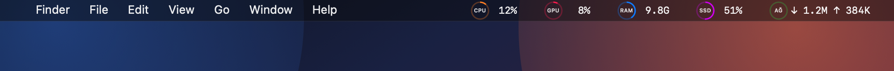
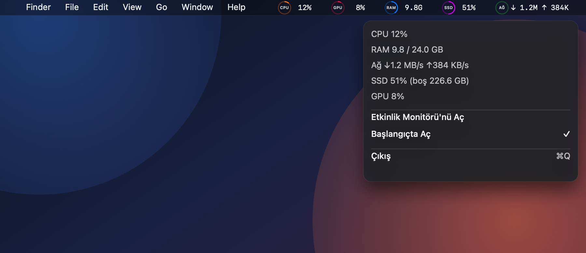

# MenuMeter

**Five system metrics, always in your menu bar.**

MenuMeter is a tiny native macOS app that keeps CPU, GPU, memory, SSD usage and network throughput visible at the same time — no clicking, no rotating text, no dashboard to open.

[](#requirements)
[](#build-from-source)
[](https://github.com/cmtrkr83/MenuMeter/releases/latest)
[](https://www.buymeacoffee.com/cmtrkr)



<p align="center"><sub>CPU · GPU · RAM · SSD · Network — each with its own colored ring and a fixed-width value.</sub></p>



## Features

- **Five metrics at once** — CPU, GPU, RAM, SSD and network download/upload.
- **Colored rings** — orange CPU, pink GPU, blue RAM, purple SSD, green network.
- **No jumping layout** — every value occupies a fixed-width slot, so the menu bar stays still as numbers change.
- **Native and lightweight** — AppKit only, no Electron, no third-party dependencies, no root access, no background daemon.
- **Three-second refresh** — updates every 3 seconds and pauses while the Mac sleeps.
- **Right-click menu** — detailed values, Activity Monitor shortcut, launch-at-login toggle and Quit.
- **Starts with your Mac** — launch at login is enabled automatically on first run and can be turned off from the menu.
- **No Dock icon** — lives only in the menu bar.

## Requirements

- macOS 13 Ventura or newer.
- Apple Silicon for the prebuilt release (build from source for other architectures).
- Swift 6.4 and Command Line Tools to build; full Xcode is not required.

## Install

1. Download `MenuMeter-1.0.dmg` from [Releases](https://github.com/cmtrkr83/MenuMeter/releases/latest).
2. Open the disk image and drag **MenuMeter** into **Applications**.
3. Launch it. On first launch, macOS may warn that the app is from an unidentified developer because the build is ad-hoc signed and not notarized:
   - Right-click **MenuMeter** in Applications and choose **Open**, or
   - allow it under **System Settings → Privacy & Security → Open Anyway**.

Launch at login is enabled on first run. Turn it off from the right-click menu at any time.

## Usage

| Action | Result |
| --- | --- |
| Left-click any metric | Opens Activity Monitor |
| Right-click any metric | Opens the details menu |
| **Başlangıçta Aç** | Toggles launch at login |
| **Çıkış** (`⌘Q`) | Quits MenuMeter |

The UI labels are currently in Turkish.

### What the values mean

| Metric | Color | Menu bar value | Details |
| --- | --- | --- | --- |
| CPU | Orange | Usage percentage | Current total CPU load |
| GPU | Pink | Usage percentage | `—` when GPU utilization is unavailable |
| RAM | Blue | Used memory | Used / total GB |
| SSD | Purple | Used space percentage | Free space in GB |
| Network | Green | Download / upload rate | Live rates in B/s, KB/s, MB/s or GB/s |

## Build from source

```bash
git clone https://github.com/cmtrkr83/MenuMeter.git
cd MenuMeter
./scripts/build_app.sh
open ~/Applications/MenuMeter.app
```

`build_app.sh` compiles a release build, copies the app icon and `Info.plist` into a bundle, ad-hoc signs it, and installs it to `~/Applications/MenuMeter.app`.

Run the test suite with:

```bash
./scripts/test.sh
```

The suite uses Swift Testing (39 tests) and covers metric ordering, fixed-width formatting, byte/rate formatting, GPU fallback, sampler math, engine lifecycle and formatting edge cases.

## Package a DMG

```bash
./scripts/make_dmg.sh
```

This builds the app and produces `dist/MenuMeter-<version>.dmg` with the app and an `Applications` shortcut for drag-and-drop installation.

## Performance

Measured on Apple Silicon with the app idle in the menu bar:

- Physical memory footprint: **~17 MB** (below the 20 MB target).
- Idle CPU: **0.0%**.
- Refresh interval: **3 s**; sampling stops during sleep.

## Project structure

```text
Sources/
  MenuMeter/          AppKit app: status items, icons, menu, login item
  MenuMeterCore/      Sampling, models and formatting (testable, no UI)
Resources/            Info.plist and AppIcon.icns
scripts/              build_app.sh, test.sh, make_dmg.sh
Tests/                Swift Testing suites for MenuMeterCore and MenuMeter
docs/screenshots/     README preview images
```

## Support

If MenuMeter is useful to you, you can buy me a coffee:

[](https://www.buymeacoffee.com/cmtrkr)

## Notes

- Screenshots are rendered previews of the actual UI, not captures of a live desktop.
- The release is ad-hoc signed and not notarized; no Apple Developer ID is used.
- MenuMeter reads system statistics locally. It does not send data anywhere.
